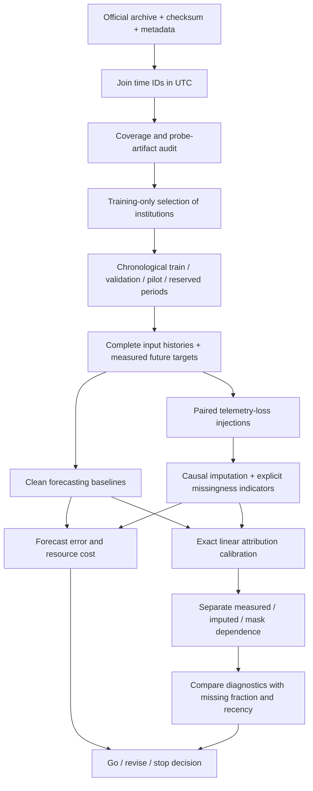

# Dataset pilihan dan pipeline baru

**Utama: CESNET-TimeSeries26, institusi, resolusi 1 jam; 12 institusi untuk pilot.** Gunakan [record resmi Zenodo](https://zenodo.org/records/21945629), bukan CSV agregat lama. Lisensi pada metadata record: CC BY 4.0. Arsip institusi sekitar 1.73 GB terkompresi; paket IP penuh tidak diperlukan. Asal capture, skema agregasi, dan artefak pengukuran dibahas dalam [descriptor 2026](https://arxiv.org/abs/2610.14799). Dokumentasi library masih menyatakan paper “in preparation”; preprint Oktober 2026 sudah tersedia. Ada perbedaan penyebutan 995/996 hari antarsumber; manifest aktual akan mencatat timestamp dan jumlah baris, tanpa menganggap kedua angka identik.

Pilihan ini menjawab pertanyaan forecasting volume dan proses pengukuran. Banyak fitur atau baris tidak menjadikan dataset cocok secara otomatis. Ukuran utamanya ialah durasi, kontinuitas waktu, unit target, provenance, lisensi, dan relevansi deployment.

| Kandidat | Keputusan | Alasan untuk tugas ini |
|---|---|---|
| CESNET-TimeSeries26 institusi | Utama | Banyak seri jaringan terukur, periode baru setelah data lama, metadata coverage/outage. Audit tetap diperlukan: jam parsial bukan nol traffic dan coverage tidak membuktikan semua probe sehat. |
| [CESNET-TimeSeries24](https://zenodo.org/records/13382427) | Reproduksi/kompatibilitas, bukan replikasi independen | Provenance resmi tersedia, tetapi bertumpang tindih jaringan dan waktu dengan CESNET26. Jangan menamai gabungan keduanya “dua jaringan”. |
| CSV global lama yang recovered | Bukti pendahuluan | Hasil terdahulu dipertahankan, tetapi komposisi agregat belum berhasil direkonstruksi dan test-nya sudah dilihat. |
| [Westermo](https://github.com/westermo/network-traffic-dataset), bottom.csv | Bukan dataset utama studi ini | Berguna untuk konteks traffic industri. **File recovered** hanya sekitar 90 menit; itu tidak cukup untuk forecast dan pola mingguan. Ini bukan penilaian bahwa seluruh dataset Westermo tidak berguna. |
| [Tcpreplay bigFlows](https://tcpreplay.appneta.com/reference/sample-captures/) | Uji parsing/replay | Sample capture untuk pengujian traffic; file recovered sekitar lima menit. Mengulang capture tidak menghasilkan minggu pengamatan independen. |
| [CTU Botnet-54](https://mcfp.felk.cvut.cz/publicDatasets/CTU-Malware-Capture-Botnet-54/) | Bukan forecast demand jangka panjang | Skenario botnet sekitar 16 jam; relevan bagi deteksi, tidak cukup untuk claim generalisasi pola demand berminggu-minggu. Tidak perlu mengunduh executable malware. |
| [VNAT binary turunan](https://zenodo.org/records/8035724) | Pisahkan sebagai tugas klasifikasi | Record berisi fitur single-flow untuk deteksi/klasifikasi. Banyak baris fitur tidak setara deret waktu agregat kronologis. Jangan campur label VPN menjadi target forecasting volume. |
| [ISCXTor2016](https://www.unb.ca/cic/datasets/tor.html) | Klasifikasi/aplikasi, bukan pilihan utama | Data Tor/non-Tor dari tugas aplikasi terkontrol. Perlu konstruksi target dan audit waktu tersendiri sebelum dipakai untuk forecasting; file Tor juga belum recovered. |
| GÉANT/Abilene | Kandidat validasi jaringan eksternal | Berguna untuk uji transfer. Belum diunduh atau diverifikasi dalam pilot ini; usia data, lisensi, timestamp, dan mekanisme pengukuran perlu diaudit dahulu. |

## Alur yang akan diuji

Forecasting dan kualitas penjelasan dinilai terpisah. Penjelasan yang faithful terhadap model masih bisa menjelaskan ketergantungan pada imputasi, bukan sebab demand jaringan. Lokasi data yang dihilangkan diketahui dalam injeksi; true demand pada outage alami tetap tidak diketahui. Klaim kausal dibatasi pada intervensi **input model**, bukan penyebab traffic dunia nyata.

Pilot linear memberi kontrol yang dapat dihitung eksak. Studi penuh dapat menambah DLinear, GRU/LSTM, dan patch forecaster setelah pertanyaan kontribusinya bertahan; arsitektur bukan sumber novelty dengan sendirinya. Implementasi detail dan kriteria eksperimen ada di PROTOCOL_PILOT.md.
