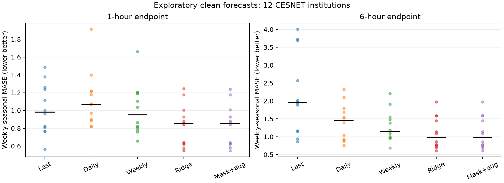
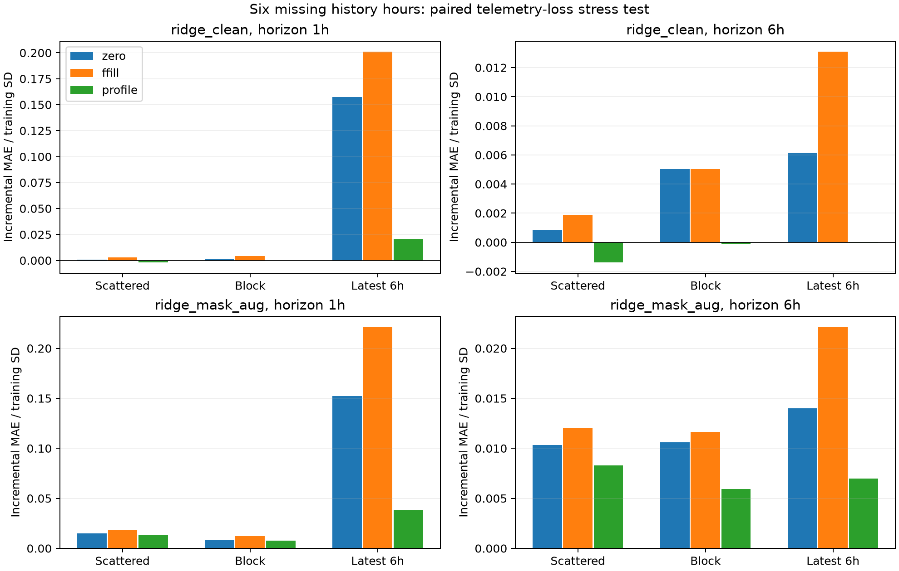

# Pilot v2: hasil dan batas kesimpulan

5 November 2026. **Exploratory pilot selesai; studi konfirmatori dan paper final belum selesai.** Tujuan tahap ini mengecek kelayakan data/pipeline dan diagnostik dasar sebelum studi neural yang lebih mahal.

## Data yang benar-benar dipakai

CESNET-TimeSeries26 resmi ([Zenodo](https://zenodo.org/records/21945629)), lisensi CC BY 4.0. Arsip institusi 1,728,712,870 byte cocok dengan checksum publisher `md5:cf06f8036df9b5b9652cbab7c148f2c5`. Pemilihan 12 institusi memakai statistik training saja; ID: 28, 42, 68, 102, 104, 107, 128, 154, 155, 206, 209, 254.

Grid aktual: 23,902 slot hourly dan 140,636 catatan 10 menit. Terdapat 485 jam yang tidak mempunyai enam catatan 10 menit. Target/input clean pilot memakai jam lengkap, nilai yang tersedia, serta screening konservatif periode probe-loss yang terdokumentasi. Coverage bukan bukti bahwa setiap probe menangkap semua traffic.

Training 2024; validasi Januari 2025; pilot Februari–Maret 2025. Horizon 1 dan 6 jam berarti **volume pada endpoint jam tersebut**, bukan akumulasi enam jam. Periode April 2025–Juni 2026 belum diberi skor. Dua keluarga Ridge dipilih alpha-nya melalui validasi; pembanding persistence, daily dan weekly memakai origin yang sama.

## Forecast clean

Angka di bawah adalah rata-rata MASE per institusi dengan denominator seasonal-naive mingguan pada training. Nilai lebih kecil lebih baik; hasil ini bukan perbandingan neural final.

| Model | MASE 1h | MASE 6h |
|---|---|---|
| persistence | 1.0142 | 2.1620 |
| daily | 1.1220 | 1.4045 |
| weekly | 1.0078 | 1.2819 |
| ridge_clean | 0.8292 | 1.1068 |
| ridge_mask_aug | 0.8297 | 1.1065 |

Kontrol Ridge tanpa clipping menghasilkan rata-rata per-institusi **6.98–7.30% prediksi negatif** pada evaluasi clean. Ini batas penting: konfigurasi tersebut belum layak menjadi forecaster volume operasional. Studi penuh perlu pembanding dengan output nonnegatif dan penjelasan yang sesuai fungsi akhirnya.

`ridge_mask_aug` menggunakan augmentation dan indikator missing sekaligus. Perbedaannya tidak mengisolasi manfaat mask; ablation tambahan diperlukan. Prediksi Ridge tidak di-clamp agar dekomposisi linear tetap eksak. Negative-output rate tersedia di clean_macro.csv.

## Dampak kehilangan enam jam input

Setiap skenario menahan target asli dan membandingkan input lengkap dengan input yang kehilangan pengukuran. Di bawah: kenaikan MAE dibagi standar deviasi training, dirata-ratakan per institusi, horizon 6 jam. Nilai negatif berarti skenario tersebut rata-rata memperkecil error dibandingkan input clean; jangan menghapus hasil seperti ini.

| Pattern | Replacement | Ridge clean Δerror/SD | Mask+aug Δerror/SD |
|---|---|---|---|
| scattered | zero | 0.00085 | 0.01033 |
| scattered | ffill | 0.00189 | 0.01206 |
| scattered | profile | -0.00139 | 0.00830 |
| block | zero | 0.00502 | 0.01062 |
| block | ffill | 0.00502 | 0.01164 |
| block | profile | -0.00010 | 0.00596 |
| tail | zero | 0.00614 | 0.01399 |
| tail | ffill | 0.01309 | 0.02209 |
| tail | profile | 0.00002 | 0.00699 |

Dalam **17/18 kondisi agregat**, mask+augmentation mempunyai kenaikan error standar lebih besar daripada Ridge clean. Kondisi-kondisi ini saling bergantung dan hitungan tersebut bukan uji signifikansi; pilot tidak mendukung klaim bahwa konfigurasi mask-aware ini otomatis lebih robust.

Semua skenario/horizon tersedia dalam stress_macro.csv dan stress_by_institution.csv. Tiga seed menentukan lokasi random; pola tail deterministik dihitung satu kali dalam analisis. Bootstrap mingguan berpasangan bersifat deskriptif dan kondisional pada institusi yang dipilih, dengan dependensi satu jaringan dan multiple comparisons yang belum dikoreksi.

## Temuan kontrol penjelasan

Rekonstruksi atribusi linear maksimum meleset 5.33e-15 GB; identitas perubahan prediksi maksimum meleset 7.99e-15 GB. Ini meloloskan pemeriksaan aritmetika, tanpa membuktikan novelty atau kegunaan operasional.

Untuk Ridge clean dengan imputasi profil yang sama dengan reference explanation:

- Massa atribusi pada nilai imputasi maksimum: **0 GB**.
- Proporsi pasangan dengan perubahan prediksi nonzero: **100.0%**.
- Proporsi pasangan dengan absolute error meningkat: **49.4%**.

Atribusi relatif-reference tetap benar. Kesimpulan “massa atribusi imputasi nol berarti forecast aman” tidak didukung. Temuan ini mengilustrasikan konsekuensi definisi yang sudah dijelaskan **sebelum** fitting di INTERPRETATION_CONTRACT.md; jangan mengklaim menemukan teorema baru atau menyebut semua explanation salah.

## Apakah sudah worth sebagai paper konferensi?

**Layak diteruskan sebagai studi empiris terfokus; pilot ini sendiri belum cukup untuk submit.** Literatur sudah memiliki XAI forecasting, missingness bias, perturbation audits dan reference controls. Nilai paper harus muncul dari hasil yang konsisten dan berguna pada situasi operasional jaringan, bukan dari kombinasi istilah tersebut.

Pilot menyediakan dataset terverifikasi, kontrol eksak dan hasil awal yang dapat diulang. Ia belum menunjukkan bahwa XAI memberi diagnosis tambahan melebihi heuristic sederhana. Korelasi yang disimpan adalah asosiasi univariat; efek kondisional/incremental utility belum diuji. Semua skenario kehilangan enam jam, sehingga missing fraction konstan dan belum dapat menjadi pembanding diskriminasi yang berarti. Bukti belum mencakup neural models, severity berbeda, outage alami yang memiliki true demand tersembunyi, atau jaringan eksternal.

Lanjut studi penuh dengan severity-varying controls, augmentation/mask ablation, beberapa keluarga model, outcome reserved dan pembanding penelitian terdekat. Jika XAI tidak menambah manfaat, laporkan hasil negatif serta kondisi batasnya; jangan menjual sebuah risk score universal.

## Reproduksi dan status

Runtime fitting/perekaman: 40.5 detik. Artifact validation: **passed**. Prefit protocol/source hashes, hash data terpilih, prediksi checkpoint, semua MAE clean dan error stress diperiksa kembali. Skrip dan konfigurasi tersimpan; lihat README.md.

Titik pada grafik clean mewakili institusi; garis hitam menunjukkan median. Tabel di atas memakai mean per institusi.

Grafik stress menampilkan mean per institusi; skala sumbu y berbeda antar panel.

